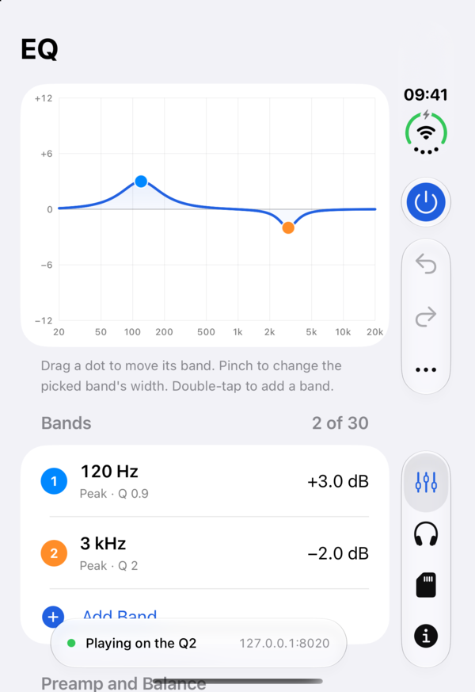
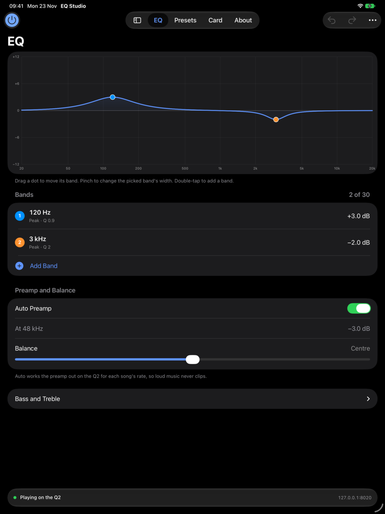

# EQ Studio for iPhone, iPad and Mac

A native app for [EQ Studio](https://github.com/DiamondBond/q2-eq-studio), Bond's Q2 Pod app for editing the
Shanling Q2's parametric EQ. It does what EQ Studio's page does, in SwiftUI on iPhone, iPhone Duo, iPad and
Mac, and talks to the same EQ Studio on the Q2.

| iPhone Duo, folded | iPad |
|---|---|
|  |  |

## Using it

1. On the Q2, open **EQ Studio** (Library → Apps). It shows a QR code.
2. Keep this device on the same Wi-Fi as the Q2 (or reach it over Tailscale).
3. Scan the code, or type the address and PIN under it.

What you change plays on the Q2 as you change it, on a Q2 Pod with live EQ. Without it, save the EQ to the
card and import it on the Q2's EQ page (**Import from SD /EQ**).

## What's in it

- **EQ:** the curve, with dots to drag, pinch for a band's width, and double-tap to add a band. Up to 30
  bands, each a peak, low shelf or high shelf, on both sides or one. Auto or fixed preamp, balance, Bass
  and Treble as Poweramp's knobs, each band's own curve, undo and redo, and the same warnings as the page.
- **Presets:** AutoEq's presets for thousands of headphones and IEMs, read from the card, searchable by
  name and type.
- **Card:** the card's EQ folder: open, save, replace, delete. Open a file, share this EQ, copy it as text
  or paste one (Equalizer APO's format).
- **Live:** EQ on or off on the Q2, what it plays, and what went wrong with a retry.
- **About:** acknowledgements, and every Q2 Pod contributor by their GitHub name, read from GitHub.

It lays itself out for the screen: a tab bar and a sheet for a band on an iPhone; a sidebar and an
inspector beside the EQ on an iPad, a Mac or an unfolded iPhone Duo.

Not here yet, from EQ Studio's page: **Response** (squig.link measurements, targets and AutoEQ's fit),
reading Poweramp's exports, the **For other apps** exports (Wavelet, miniDSP, impulse responses, a
picture), Inspect, and the rest of the computer's keys.

## Building

Needs Xcode 27 and [XcodeGen](https://github.com/yonaskolb/XcodeGen).

```sh
xcodegen generate            # EQStudio.xcodeproj, from project.yml
open EQStudio.xcodeproj      # then run on an iPhone, iPad or Mac
cd Packages/EQCore && swift test
```

`Packages/EQCore` is EQ Studio's EQ logic (`web/eq.js`) in Swift: a preset's text, the Q2's limits and
the curve, as Q2 Pod's `patch/peq.c` reads and plays them. Its tests are the page's, case for case, and
read back every AutoEq preset.

A debug build signs in from `EQS_LINK=<the QR code's link>` at launch, for a simulator, which has no
camera. EQ Studio runs on a computer too (its README, Building), so the app can be tried without a Q2.

## Credits

- **EQ Studio** by Bond ([DiamondBond](https://github.com/DiamondBond)), GPL-3.0: every feature here, the API
  it talks to, and the app's icon, which is EQ Studio's own (`docs/eq-studio-icon.svg`).
- **Q2 Theme Studio** by Tyler ([tyleree](https://github.com/tyleree)), GPL-3.0: EQ Studio's EQ, whose logic
  `EQCore` ports.
- **AutoEq** by Jaakko Pasanen, MIT: the presets.
- **PEQdB Studio**, **File Browser** by group-a-study, and **squig.link**, as EQ Studio credits them.

## Licence

GPL-3.0-only (`LICENSE`), as EQ Studio is. Not affiliated with Shanling.
