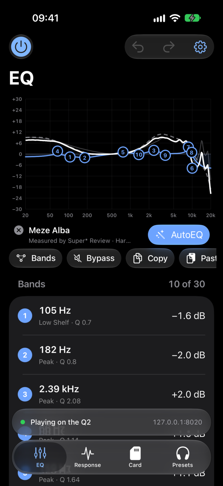
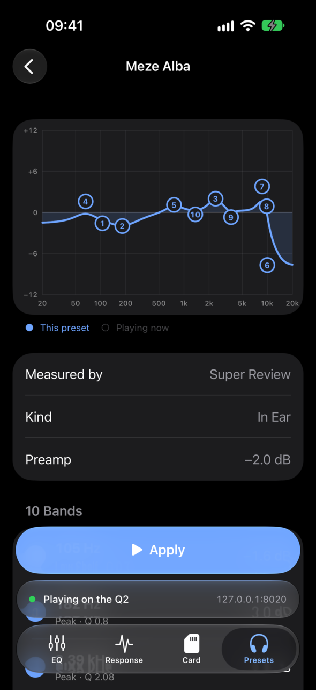
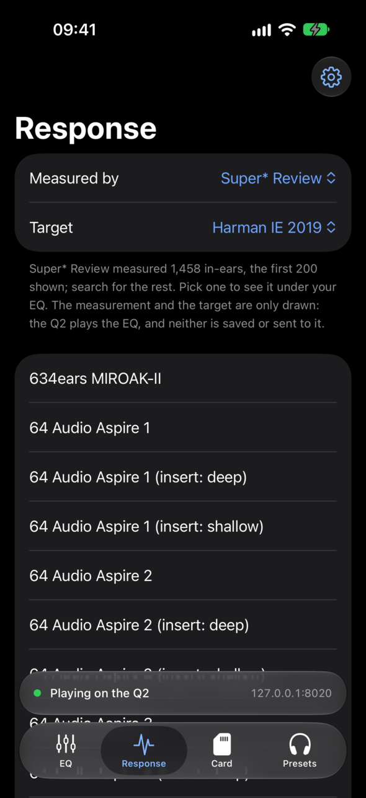

# EQ Studio for iPhone and iPad

A native app for [EQ Studio](https://github.com/DiamondBond/q2-eq-studio), the [Q2 Pod](https://github.com/DiamondBond/q2-pod)
app for editing the Shanling Q2's parametric EQ. It does what EQ Studio's page does, in SwiftUI, and talks to
the same EQ Studio running on the Q2: what you change plays on the Q2 as you change it.

| EQ | Presets | A preset | Response | About |
|---|---|---|---|---|
|  |  |  |  |  |

## Using it

1. On the Q2, open **EQ Studio** (Library → Apps). It shows a QR code.
2. Keep the iPhone or iPad on the same Wi-Fi as the Q2.
3. Tap **Scan Code** and point the camera at it, or **Type PIN** and enter the address and PIN under the code.

Away from the Q2's Wi-Fi, use its Tailscale address instead, with Tailscale on both: the
[Tailscale app for Q2 Pod](https://github.com/js-surya/q2-tailscale) shows it under **Settings → Apps Shared Now**.
The app keeps both addresses and uses whichever answers.

## What's in it

Everything on EQ Studio's page, its logic ported from the page's JavaScript along with its tests:

- **EQ:** the curve; drag a dot or the curve itself, pinch for a band's width, double-tap to add a band,
  touch and hold to read the curve. Up to 30 bands (peak, low or high shelf, both sides or one), Auto or
  fixed preamp, balance, Bass and Treble as Poweramp's knobs, each band's own curve, bypass, undo and redo.
- **Presets:** AutoEq's presets for thousands of headphones and IEMs, searched by name, filtered by kind;
  each opens on its own page to look at before **Apply** plays it.
- **Response:** a reviewer's measurement from [squig.link](https://squig.link) under the EQ (Measured, a target,
  Measured + EQ), and **AutoEQ** to fit the bands to the target.
- **Card:** the card's EQ folder (open, save, replace, delete), open a file, paste a preset's text or a
  Poweramp export, and **For other apps**: Wavelet, miniDSP biquads, impulse responses (.wav), a picture.
- **Live:** EQ on or off on the Q2, what it plays, and what went wrong with a retry.
- **The rest:** the curve's rate (44.1 to 192 kHz), light, dark or the system's, an accent of your choice,
  haptics, a keyboard's shortcuts on an iPad, and About with the credits and every Q2 Pod contributor.

It needs iOS or iPadOS 26, and EQ Studio on a Q2 Pod with live EQ to play changes as you make them (without
it, it's an editor: save to the card and import on the Q2).

## Building

Needs Xcode 27 and [XcodeGen](https://github.com/yonaskolb/XcodeGen).

```sh
xcodegen generate                    # EQStudio.xcodeproj, from project.yml
open EQStudio.xcodeproj              # pick your team under Signing, then run on an iPhone or iPad
cd Packages/EQCore && swift test     # the EQ logic and its tests
```

`Packages/EQCore` is EQ Studio's logic in Swift: `web/eq.js` (a preset's text, the Q2's limits, the curve),
`formats.js`, `poweramp.js`, `squig.js` and `fit.js`, each with its tests case for case. The tests also read
back every AutoEq preset (`Tests/EQCoreTests/presets.json.gz`, AutoEq's, MIT).

A debug build takes a few launch settings for the simulator, which has no camera: `EQS_LINK=<the QR code's
link>` signs in, `EQS_TAB=presets|response|card` opens a tab. [EQ Studio](https://github.com/DiamondBond/q2-eq-studio)
also runs on a computer (its README, Building), so the app can be tried without a Q2.

## Credits

- **[EQ Studio](https://github.com/DiamondBond/q2-eq-studio)** by [DiamondBond](https://github.com/DiamondBond), GPL-3.0:
  every feature here, the API it talks to, and the icon, which is EQ Studio's own.
- **[Q2 Pod](https://github.com/DiamondBond/q2-pod)** by DiamondBond and its contributors: the firmware that plays the EQ.
- **Q2 Theme Studio** by [tyleree](https://github.com/tyleree), GPL-3.0: EQ Studio's EQ, whose logic `EQCore` ports.
- **[AutoEq](https://github.com/jaakkopasanen/AutoEq)** by Jaakko Pasanen, MIT: the presets.
- **[squig.link](https://squig.link)** and its reviewers: the measurements and targets.
- **PEQdB Studio** and **[File Browser](https://github.com/group-a-study/q2-filebrowser)**, as EQ Studio credits them.

## Licence

GPL-3.0-only (`LICENSE`), as EQ Studio is. Not affiliated with Shanling or Apple.
