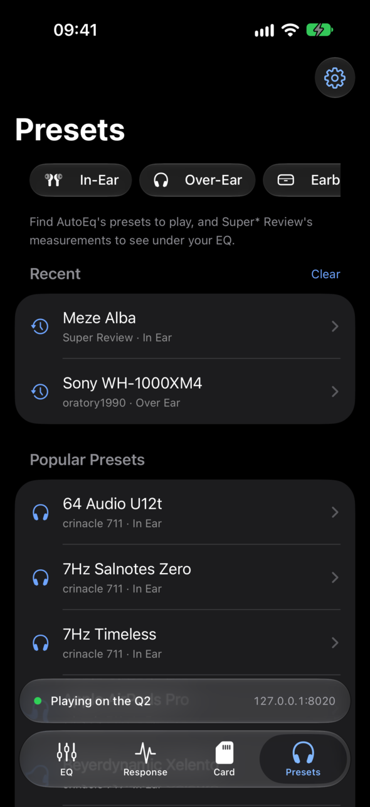
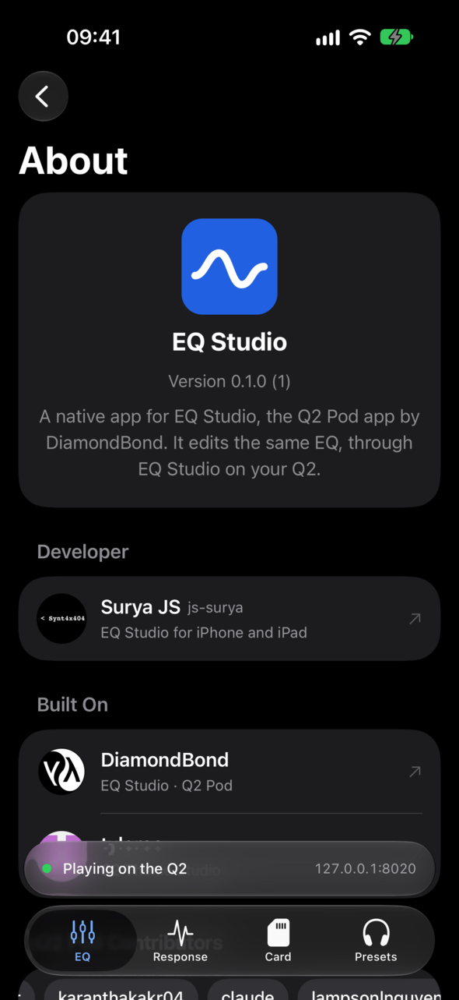

<p align="center">
  
</p>

<h1 align="center">EQ Studio for iPhone and iPad</h1>

<p align="center"><strong>Your Q2's EQ, in your hand.</strong></p>

<p align="center">
  A native iPhone and iPad app for <a href="https://github.com/DiamondBond/q2-eq-studio">EQ Studio</a>, the
  <a href="https://github.com/DiamondBond/q2-pod">Q2 Pod</a> app that edits the Shanling Q2's parametric EQ.<br>
  Shape the curve, pick a preset for your headphones, and hear it on the Q2 as you go.
</p>

<p align="center">
  
  
  
  
  <a href="LICENSE"></a>
</p>

<p align="center">
  
  
  
  
  
</p>

> This app talks to EQ Studio on the Q2 and does what EQ Studio's page does. Its EQ logic is EQ Studio's,
> ported to Swift with its tests, with the blessing of EQ Studio's and Q2 Theme Studio's authors. It's not
> affiliated with Shanling.

## Features

**Shape**
- The curve: drag a dot or the curve itself, pinch for a band's width, double-tap to add a band, touch and hold to read it
- Up to 30 bands (peak, low or high shelf, on both sides or one), Auto or fixed preamp, balance
- Bass and Treble as Poweramp's knobs, each band's own curve, bypass, undo and redo
- Haptics at each dB, at 0 dB and at the limits

**Find**
- AutoEq's presets for thousands of headphones and IEMs, searched by name and filtered by kind
- Each preset on its own page, its curve over yours, before **Apply** plays it
- **Response:** a reviewer's measurement from [squig.link](https://squig.link) under your EQ, a target, and **AutoEQ** to fit the bands to it

**Keep and share**
- The card's EQ folder: open, save, replace, delete
- Open a file, paste a preset's text or a Poweramp export
- For other apps: Wavelet, miniDSP biquads, impulse responses (.wav), a picture of the graph

**Yours**
- Hear it live, EQ on or off on the Q2, and what went wrong with a retry
- No Q2 at hand? **Try Without a Q2** edits the EQ on the phone, with Presets and Response
- Sign in by scanning the Q2's code or with its PIN; on your Wi-Fi or over [Tailscale](https://github.com/js-surya/q2-tailscale), whichever answers
- Light or dark, an accent of your choice, keyboard shortcuts on an iPad

## Download

Coming to TestFlight, then the App Store. Until then, build it yourself (below); [Releases](../../releases) list what
changed in each version.

## Requirements

- A Shanling Q2 with [Q2 Pod](https://github.com/DiamondBond/q2-pod) and [EQ Studio](https://github.com/DiamondBond/q2-eq-studio) (from its App Store); a Q2 Pod with live EQ plays changes as you make them
- iOS / iPadOS 26 or later

## Build

You need Xcode 27 or later and [XcodeGen](https://github.com/yonaskolb/XcodeGen) (`brew install xcodegen`).

```sh
git clone https://github.com/js-surya/q2-eq-studio-ios.git
cd q2-eq-studio-ios
cp Config/Signing.xcconfig.example Config/Signing.xcconfig   # put your Apple Team ID in it
xcodegen generate
open EQStudio.xcodeproj
```

No Q2 at hand? Tap **Try Without a Q2** on the first screen. To test talking to a Q2, EQ Studio runs on a computer
too (its README, Building): start the app in the simulator with `EQS_LINK=<the link EQ Studio prints>` and it signs in.

Run the tests and the build before a pull request:

```sh
scripts/test.sh
```

## Project layout

| Path | What's there |
|---|---|
| `Packages/EQCore` | The EQ logic, as a Swift package: EQ Studio's `web/eq.js` (a preset's text, the Q2's limits, the curve), `formats.js`, `poweramp.js`, `squig.js` and `fit.js`, each with its tests, which also read back every AutoEq preset |
| `App/` | The app: talking to EQ Studio, the EQ, Presets, Response, Card and Settings |
| `Config/` | Build settings; your signing team goes in `Signing.xcconfig` (gitignored) |
| `docs/` | Screenshots, the [privacy policy](docs/PRIVACY.md) and the [App Store notes](docs/APP_STORE.md) |

## Privacy

The app collects no data: no analytics, tracking or ads, and no server of its own. It talks only to:

- **EQ Studio on your Q2**, at the address you scan or type
- **squig.link**, for the measurements and targets you pick
- **GitHub**, for AutoEq's preset list while you try the app without a Q2, and for the profile pictures of the
  three people in About (the developer, DiamondBond and tyleree)

Details are in the [privacy policy](docs/PRIVACY.md).

## Contributing

Bug reports and ideas are welcome. Please use the [issue forms](../../issues/new/choose), and see
[CONTRIBUTING.md](.github/CONTRIBUTING.md) before opening a pull request.

## Credits

Made with ❤️ by [Surya JS](https://github.com/js-surya).

- **[EQ Studio](https://github.com/DiamondBond/q2-eq-studio)** by [DiamondBond](https://github.com/DiamondBond), GPL-3.0: every feature here, the API it talks to, and the icon, which is EQ Studio's own
- **[Q2 Pod](https://github.com/DiamondBond/q2-pod)** by DiamondBond and its contributors: the firmware that plays the EQ
- **Q2 Theme Studio** by [tyleree](https://github.com/tyleree), GPL-3.0: EQ Studio's EQ, whose logic `EQCore` ports
- **[AutoEq](https://github.com/jaakkopasanen/AutoEq)** by Jaakko Pasanen, MIT: the presets ([licence](Packages/EQCore/Tests/EQCoreTests/AUTOEQ-LICENSE.txt))
- **[squig.link](https://squig.link)** and its reviewers: the measurements and targets
- **PEQdB Studio** and **[File Browser](https://github.com/group-a-study/q2-filebrowser)**, as EQ Studio credits them

## Licence

GPL-3.0-only ([LICENSE](LICENSE)), as EQ Studio is. Its authors allow it to be distributed through TestFlight and the
App Store. The icon is EQ Studio's: if you publish your own build, please use a different name and icon.

Report security problems privately; see [SECURITY.md](.github/SECURITY.md). Everyone taking part follows the
[code of conduct](.github/CODE_OF_CONDUCT.md).
